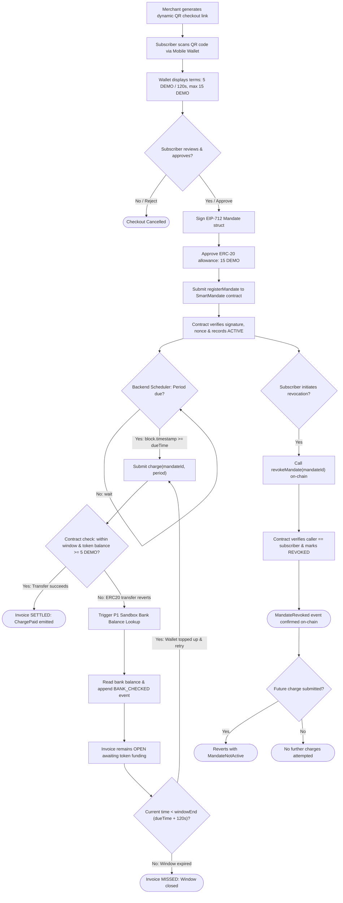

# Phase 0 Build Specification — Smart Mandates Recurring Billing

> **Project 10 — Automated Subscription & Recurring Billing via Smart Mandates**
> Capstone Stage: Phase 0 (Planning, Specifications & Architecture)
> Document Version: 1.0.0 | Status: APPROVED FOR PHASE 1

---

## 1. System Overview & Core Architecture

Project 10 enables non-custodial recurring subscription payments on the Ethereum blockchain (Sepolia testnet and local EVM). The system eliminates manual monthly approvals by introducing cryptographic smart mandates: a subscriber approves terms once via an EIP-712 signature and token allowance cap, after which a backend keeper autonomously executes due charges through a Solidity pull-payment contract.

### 1.1 Demo Defaults

| Parameter | Specification | Value in Base Units / Format |
|-----------|---------------|------------------------------|
| **Merchant Name** | `AcmeCorp` (fictional) | `"AcmeCorp Subscription Services"` |
| **Merchant Address** | Dummy hardhat account #1 | `0x70997970C51812dc3A010C7d01b50e0d17dc79C8` |
| **Payout Address** | Payout recipient address | `0x70997970C51812dc3A010C7d01b50e0d17dc79C8` |
| **Subscription Token** | `DemoToken` (`DEMO`) | Mock ERC-20 token, 18 decimals |
| **Charge per Period** | Exactly 5 DEMO tokens | `5000000000000000000` (`5 * 10^18`) |
| **Billing Interval** | 120 seconds (2 minutes) | `120` |
| **Billing Periods** | 3 scheduled cycles | `3` (indexed `0`, `1`, `2`) |
| **Maximum Allowance Cap**| Exactly 15 DEMO tokens | `15000000000000000000` (`15 * 10^18`) |
| **Replay Prevention Nonce**| Per-subscriber incremental | `1` (for initial mandate) |
| **Sandbox Bank Lookup** | Balance verification service | Returns available fiat liquidity without auto-debit |

---

## 2. End-to-End System Flowchart

---

## 3. Core Billing Rules

The system strictly enforces the following six billing rules across the smart contract, backend worker, and user interfaces:

1. **Anchored to First Due Time**
   Billing periods are strictly anchored to `firstDueTime` ($T_0$). Period index $n \in \{0, 1, 2\}$ has an opening due time $T_n = T_0 + n \times \text{interval}$ and an expiration closing time $W_n = T_0 + (n + 1) \times \text{interval}$.
   A charge submitted before $T_n$ reverts with `ChargeTooEarly`.

2. **Single Settlement per Period**
   Each period $(mandateId, n)$ can settle exactly once. Once the smart contract transfers tokens for period $n$, the internal flag `_invoiceSettled[mandateId][n]` is set to `true`. Any subsequent call to `charge()` for that same period reverts with `InvoiceAlreadySettled`.

3. **Active Period Window & Retry Semantics**
   The active settlement window for period $n$ is the half-open interval $[T_n, W_n)$. If a charge attempt fails (for example, due to insufficient token balance or insufficient allowance), the period remains unsettled. The backend may retry `charge(mandateId, n)` as many times as necessary, provided the transaction is mined before $W_n$.

4. **Unpaid Period Expiration (Missed Period)**
   If an invoice is not settled before the period window closes ($block.timestamp \ge W_n$), the invoice permanently transitions to the `MISSED` state. The smart contract strictly reverts any charge attempt submitted at or after $W_n$ with `ChargeWindowClosed`. Missed periods are never retroactive.

5. **On-Chain Revocation Authority**
   The subscriber may call `revokeMandate(mandateId)` at any time from their wallet. Revocation takes effect immediately upon transaction confirmation on-chain (`MandateRevoked` event emitted). Once revoked, the mandate state transitions to `REVOKED`, and any pending or subsequent charge attempts immediately revert with `MandateNotActive`.

6. **Sandbox Bank Balance Lookup & Invoice State Decoupling**
   When a subscriber has insufficient tokens, the backend queries the sandbox bank API to read available liquidity and logs a `BANK_CHECKED` event. The bank lookup is diagnostic only; it does not debit the bank account. The invoice remains in the `OPEN` state until an actual ERC-20 `charge()` transaction settles on-chain.

---

## 4. Demo Scenarios

### Scenario A: Normal Happy-Path Billing (All 3 Periods Settle)
- **Setup**: Subscriber wallet is pre-funded with 15 DEMO and sets token allowance to 15 DEMO. `firstDueTime` is set to $T = 1800000000$.
- **Period 0 ($T$)**: Backend worker calls `charge(mandateId, 0)`. 5 DEMO transferred to merchant. Contract emits `ChargePaid`. Subscriber balance: 10 DEMO. Invoice `(mandateId, 0)` is `SETTLED`.
- **Period 1 ($T + 120$)**: Worker calls `charge(mandateId, 1)`. 5 DEMO transferred. `ChargePaid` emitted. Subscriber balance: 5 DEMO. Invoice `(mandateId, 1)` is `SETTLED`.
- **Period 2 ($T + 240$)**: Worker calls `charge(mandateId, 2)`. Final 5 DEMO transferred. `ChargePaid` emitted. Subscriber balance: 0 DEMO. Invoice `(mandateId, 2)` is `SETTLED`.
- **Completion**: Mandate state automatically transitions to `COMPLETED`.

### Scenario B: Insufficient Balance Followed by Recovery & Retry
- **Setup**: Subscriber has only 3 DEMO tokens at period 0 due time $T$.
- **Initial Attempt ($T$)**: Worker invokes `charge(mandateId, 0)`. The underlying ERC-20 `transferFrom` reverts due to insufficient balance.
- **Bank Fallback ($T + 10$)**: Backend catches revert, calls sandbox bank API, and receives `{ available: true, balance: "250.00", currency: "USD" }`. Backend logs `BANK_CHECKED` event against invoice `(mandateId, 0)`. The invoice remains `OPEN`.
- **Top-Up ($T + 40$)**: Subscriber transfers 10 DEMO into their wallet (within the Period 0 window $[T, T + 120)$).
- **Retry Attempt ($T + 50$)**: Worker retries `charge(mandateId, 0)`. The transaction succeeds, 5 DEMO is transferred, and `ChargePaid` is emitted.
- **Subsequent Cycles**: Periods 1 and 2 proceed according to standard schedule.

### Scenario C: On-Chain Revocation Blocks Pending Charges
- **Setup**: Period 0 has settled normally at $T$.
- **Revocation ($T + 90$)**: Prior to the opening of Period 1 ($T + 120$), the subscriber invokes `revokeMandate(mandateId)` from their wallet. The transaction confirms on-chain at $T + 95$, transitioning the mandate state to `REVOKED` and emitting `MandateRevoked`.
- **Blocked Charge ($T + 120$)**: At Period 1 due time, the backend worker attempts `charge(mandateId, 1)`. The contract reverts with `MandateNotActive(mandateId, 2)`.
- **Final Outcome**: Zero tokens are transferred for Period 1 or Period 2. The invoice remains uncollected and the subscriber balance remains protected.

---

## 5. Acceptance Criteria (P1 – P4)

### P1 — Sandbox Bank Balance Lookup
- [ ] Backend provides `checkBankBalance(subscriberBankId, requiredAmount)` returning `{ available: boolean, balance: string, currency: string }`.
- [ ] Backend appends an immutable `BANK_CHECKED` audit entry to the off-chain invoice record upon token charge failure.
- [ ] Invoice state strictly remains `OPEN` following a successful bank balance check.
- [ ] Network errors, rate limits, or non-200 responses from the sandbox bank API are caught and logged without crashing the billing worker.
- [ ] Unit tests verify fallback triggering when ERC-20 pull payment reverts.

### P2 — Dynamic QR Checkout and Mobile Wallet Signing
- [ ] Merchant service generates a QR code encoding all mandatory EIP-712 parameters (merchant, payout address, token, amount, interval, firstDueTime, maxCharges, expiry, nonce, signingDeadline).
- [ ] Frontend review screen displays formatted amounts ("5 DEMO"), interval ("Every 2 minutes"), and maximum cap ("15 DEMO").
- [ ] Subscriber wallet successfully signs using standard `eth_signTypedData_v4` matching the domain and type hashes.
- [ ] Wallet executes ERC-20 `approve(contractAddress, 15000000000000000000)` prior to on-chain registration.
- [ ] Frontend verifies `MandateRegistered` event confirmation before displaying subscription active state.

### P3 — Scheduled Testnet Charges and Batch Settlement
- [ ] Worker calculates period windows using integer arithmetic: $T_n = T_0 + n \times 120$ and $W_n = T_n + 120$.
- [ ] Worker dispatches `charge(mandateId, billingPeriod)` on-chain only when $block.timestamp \ge T_n$.
- [ ] Worker marks unsettled invoices as `MISSED` once current time exceeds $W_n$.
- [ ] Worker handles transaction retries with proper gas price escalation for `OPEN` invoices.
- [ ] Integration test simulates 3 scheduled periods on a local Hardhat node, successfully verifying 3 `ChargePaid` events.

### P4 — Solidity Pull Payments and On-Chain Revocation
- [ ] `registerMandate` verifies signature validity via `ECDSA.recover`, asserts subscriber nonces, enforces deadlines, and stores mandate as `ACTIVE`.
- [ ] `charge` executes `transferFrom(subscriber, merchant, amount)` and emits `ChargePaid`.
- [ ] `charge` reverts if called too early (`ChargeTooEarly`), after window close (`ChargeWindowClosed`), if already settled (`InvoiceAlreadySettled`), or if expired (`MandateExpired`).
- [ ] `revokeMandate` is callable exclusively by `mandate.subscriber` and transitions state to `REVOKED`.
- [ ] Total lifetime debited tokens cannot exceed `maxCharges * amount` (enforced by single settlement per period and token allowance).
- [ ] Full automated test suite achieves 100% branch and statement coverage on all revert and success conditions.

---

## 6. Open Decisions & Architecture Decision Records (ADRs)

| ADR ID | Decision Item | Proposed Direction | Status / Input Needed | Stakeholder |
|--------|---------------|--------------------|-----------------------|-------------|
| **OD-1** | **Banking Sandbox Choice** | Mock Banking Service (Phase 1) transitioning to Plaid Sandbox or TrueLayer (Phase 3) | **FLAGGED FOR INSTRUCTOR / TEAM INPUT**: Confirm whether an external sandbox account (e.g. Plaid API credentials) is provided or if a self-contained mock service is preferred for grading. | Instructor / Team |
| **OD-2** | **Contract Test Framework** | Hardhat with Chai and ethers.js v6 | **PROPOSED**: Hardhat environment is already set up and configured; keep as standard. | Smart Contract Team |
| **OD-3** | **Sepolia RPC Provider** | Alchemy or Infura Sepolia endpoint | **TEAM INPUT**: Supply shared team project API key in `.env.local` for testnet staging. | DevOps |
| **OD-4** | **Frontend Stack** | Vite + React with RainbowKit / wagmi | **PROPOSED**: Modern, lightweight, standard support for EIP-712 typed signing. | Frontend Engineer |
| **OD-5** | **Off-Chain Invoice Store** | SQLite database with Prisma ORM (or file-backed JSON for demo) | **TEAM INPUT**: Decide whether SQLite or pure JSON persistence is preferred for local demo simplicity. | Backend Engineer |
| **OD-6** | **Subscriber Revocation UX** | Dedicated "Manage Subscriptions" wallet UI page with 1-click on-chain revocation button | **PROPOSED**: Direct Web3 call to `SmartMandate.revokeMandate()`. | Frontend Engineer |
| **OD-7** | **Gas & Nonce Management** | Single keeper EOA with sequential nonce queuing and standard EIP-1559 fees | **PROPOSED**: Hardhat/Sepolia keeper account funded with testnet ETH. | Backend Engineer |
